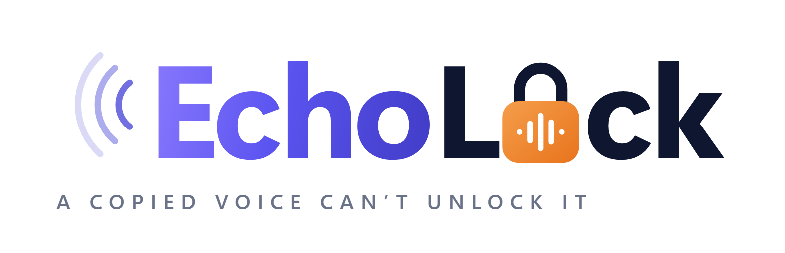

<p align="center"></p>

# EchoLock

**A copied voice can't unlock a bank account.**

Our entry for RAKSHAM (Amazon AI Cyber Security Hackathon, IIT Delhi), challenge **PS-01: Voice Cloning Fraud Detection**. Team RapidActionForce, Delhi Technological University.

📄 **Submission PDF:** [`submission/echolock/EchoLock_RapidActionForce_Submission.pdf`](submission/echolock/EchoLock_RapidActionForce_Submission.pdf), with a 10-slide pitch, 3-page architecture and 1-page appendix.

## The problem

A few seconds of someone's voice from a reel or a voice note is enough to clone it. A fraudster then calls the victim's bank as the victim and asks the agent to change the registered mobile number or raise a transfer limit. Once the number is changed, OTPs go to the fraudster.

We put the defence **in the bank's contact centre**, not on the customer's phone. On a phone, third-party apps can't read call audio: Android reserves `CAPTURE_AUDIO_OUTPUT` for system apps, Play has banned Accessibility-based call recording since May 2022, and iOS has no API for it. The bank already has the call audio on its own line.

## How it works

1. **Detect.** An anti-spoofing model (wav2vec 2.0, NII AntiDeepfake) scores the caller's audio in 4 s windows on the bank's call leg. When audio is too short or too noisy it says UNKNOWN rather than guess "genuine".
2. **Confirm.** Every sensitive change is held until the real customer approves *that exact change* in their already-registered bank app. The approval is signed, single-use and expires in 60 s. A clone can copy a voice, but it can't copy a registered phone and its biometric unlock.
3. **Review.** A flagged call opens an analyst case with reason codes and a score timeline, even if the app approval arrives. Contact and limit changes also wait 24 h, so a coached customer can cancel.

A missed clone still can't change anything, because the approval never comes. A false alarm costs a genuine caller one tap in the app. A voice score on its own never blocks, freezes or accuses anyone.

## What we measured

We ran the detector on 1,610 Hindi clips (real speech from Kathbath, clones made with XTTS-v2 and FreeVC from IndicSynth) through six simulated phone channels. The split is speaker-disjoint, and τ is fixed on a dev split at 1% false alarms.

| Channel | EER [95% CI] | Clones caught at τ | False alarms at τ |
|---|---|---|---|
| Clean 16 kHz | 1.6% [0.8–2.7] | 95.8% | 0.7% |
| G.711 (8 kHz) | 3.4% [2.1–5.0] | 96.6% | 3.9% |
| Opus 12k | 5.9% [3.5–8.5] | 93.9% | 5.3% |
| AMR-NB 12.2k | 8.5% [5.4–11.8] | 83.8% | 3.5% |
| G.711 + 3% packet loss + noise | 21.7% [17.0–25.7] | 26.0% | 0.7% |

- **Codecs are survivable; packet loss plus noise is not.** This is why the app confirmation, not the score, carries the safety guarantee.
- **τ shifts by more than 3 units between channels**, so it has to be set per codec.
- **Our own voices:** 117 sentence clips from two teammates recorded on their phones. They raise 1.7% false alarms on clean audio but 16% on G.711. A threshold from public data doesn't transfer as-is, which is why banks would calibrate in shadow mode first.
- **Speed:** 22 ms per 4 s window on a laptop RTX 3050, 0.3 s on CPU.

Full numbers, per-tool detection and caveats are in [`eval/RESULTS.md`](eval/RESULTS.md).

## Repository

| Path | Contents |
|---|---|
| [`submission/echolock/`](submission/echolock) | The submission PDF, its HTML sources, the logo and `build_pdf.py` |
| [`eval/`](eval) | Detector evaluation: fairseq-free model loader, phone-channel simulation, data fetchers, metrics, per-clip scores |
| [`prototype/`](prototype) | Node.js simulation of the Confirm and Review layers: policy engine, P-256 signed confirmations, analyst view. 26 tests |
| [`data_collection/`](data_collection) | Recording script and the two teammates' recordings (CC BY-NC, no cloning) |
| [`docs/`](docs) | [System design](docs/system_design.md) and [model architecture](docs/model_architecture.md) |

## Running it

**Prototype** (Node 20+, no dependencies):
```
cd prototype
npm test
npm start          # http://localhost:8787
```

**Evaluation:** see [`eval/README.md`](eval/README.md). It needs Python 3.11 and PyTorch, and downloads about 6 GB of streamed audio.

**Rebuild the PDF** (needs Microsoft Edge and `pypdf`):
```
python eval/make_appendix.py
python submission/echolock/build_pdf.py
```

## Honest limits

- The prototype's voice scores are fixtures. Wiring `eval/model.py` into it, plus a live consented XTTS-v2 clone call, is the 48-hour finale build.
- Real and cloned test clips come from different corpora, which may make detection look easier than it is.
- The detector weights are CC BY-NC-SA 4.0 (research only). A production deployment would need a licensed model and data.

## Team

Tushar Singh Bisht · Reedhan Garg · Shobhit Pandey · Shikhar Singh, Delhi Technological University

Code is MIT-licensed (see [`LICENSE`](LICENSE)). Datasets and model weights keep their own licences. AI assistance (Claude) was used for parts of the code, deck and docs; see the disclosure in the PDF appendix.
