# EchoLock: system design

> **Detect suspicious voice. Independently confirm the action.**
>
> A bank contact-centre gateway that flags possible voice impersonation before a sensitive account change, then obtains action-specific confirmation through a separately registered bank-app channel or routes the request to safe human review.

**Selected track:** PS1, Voice Cloning Fraud Detection. **Primary user:** bank contact-centre agent / fraud analyst. **Protected customer:** someone whose publicly exposed voice is cloned to impersonate them. **Harmful moment:** the bank is about to raise a transfer limit or change a registered device based on a caller's request.

This is a design for a bank pilot, not a deployed integration. The workflow prototype in `prototype/` uses simulated detector observations and real browser signatures; the detector itself is measured separately in `eval/` (see `eval/RESULTS.md`).

## Why this boundary

- The bank controls the call leg and the requested action; we do not rely on restricted consumer call recording, caller-number visibility or cooperation from an unrelated payment app.
- The problem stays explicitly about **voice cloning**: an acoustic anti-spoofing model is the primary technical detector, and voice impersonation is the primary attack.
- A high speaker-match score or convincing voice never authorises an account change. No new voice enrollment is needed.
- A phone-codec mismatch or detector failure causes uncertainty, not an accusation. Separate action confirmation protects the workflow even when the detector misses a clone.
- A legitimate synthetic/assistive voice can complete the same non-voice confirmation as anyone else. No disability whitelist is needed.

## Threat model and assumptions

**Attacker can:** obtain a public/consented reference voice in the test setting; synthesize or convert speech; replay it; add compression/noise; spoof caller ID; request a sensitive bank action; attempt challenge replay and social-engineer an approval.

**Not assumed solved:** bank-app/device compromise, stolen unlocked devices, malware, coercion, colluding registered users, compromised bank core or credential registry. An approval does not prove that the caller is the account owner. A verified customer can still be deceived.

**Dependencies:** authorised bank media access; an existing independently authenticated registered-app channel; bank-owned action APIs; a consent/notice process; a staffed alternative recovery path; permitted model/data licences. A new app/device cannot approve its own registration using only a credential supplied by the caller.

**Prototype substitutions:** browser-generated P-256 key instead of a real registered-bank credential; simulated call/action events; detector fixtures instead of live model inference; in-memory state; demo analyst controls instead of enterprise identity.

## Architecture overview — page 1: system and data boundaries

```mermaid
flowchart LR
  subgraph A[Boundary A: authorised bank contact centre]
    CALL[Caller audio: bank-owned leg]
    ADAPTER[Media adapter: WebRTC / SIP fork]
    CONTEXT[Trusted action context: customer ID, action ID, exact limit/device change]
    CONSENT[Notice and authorised processing gate]
    CALL --> ADAPTER --> CONSENT
  end

  subgraph B[Boundary B: bank-controlled inference service]
    BUFFER[Bounded PCM ring buffer; no new audio archive]
    QUALITY[Format / clipping / speech sufficiency gate]
    MODEL[One pretrained anti-spoofing scorer]
    AGG[Rolling speech-window aggregation; hysteresis; UNKNOWN state]
    POLICY[Policy state machine; reason codes; no score-only denial]
    CONSENT --> BUFFER --> QUALITY
    QUALITY -- sufficient speech --> MODEL --> AGG --> POLICY
    QUALITY -- insufficient / unsupported --> POLICY
    CONTEXT --> POLICY
  end

  subgraph C[Boundary C: independent registered-bank channel]
    CHALLENGE[Challenge registry: nonce, expiry, action digest, consumed flag]
    APP[Existing bank app: display EXACT action; approve or reject]
    VERIFIER[Authenticated response + signature / existing bank authentication]
    POLICY --> CHALLENGE --> APP --> VERIFIER --> POLICY
  end

  subgraph D[Boundary D: operations and bank action authority]
    AGENT[Agent UI: uncertainty / elevated suspicion / confirmation state]
    CASE[Minimal evidence store; RBAC; TTL]
    ANALYST[Analyst: callback, investigate, release, cancel request]
    CORE[Bank policy + existing authentication + action API]
    POLICY --> AGENT
    POLICY --> CASE --> ANALYST
    POLICY -- eligible only; never direct model execution --> CORE
    ANALYST -- authorised decision --> CORE
  end
```



**Diagram caption:** audio remains within an authorised bank processing boundary; the app-confirmation channel never uses information supplied by the suspicious caller as its trust root. The existing bank action API retains final authority. Reviewers can understand the entire diagram without following a link.

### Components and interfaces

| Component | Input | Output / interface | MVP implementation |
|---|---|---|---|
| Call adapter | Authorised mono PCM; call/session ID; notice state | WebSocket chunks / observation events | Stream consenting recording or bank-owned WebRTC session; SIP integration is later |
| Quality gate | Sample rate, speech seconds, clipping/dropout and duration | `usable` / `insufficient` / `unsupported`, reason codes | Duration/format/speech checks; clip/noise thresholds evaluated on data, not assumed proof |
| Acoustic scorer | Sufficient 16 kHz mono speech, preserving knowledge of original channel | Raw class logits, model ID/revision, processing time | **First choice:** NII `wav2vec-small-anti-deepfake` as published. If not reproducible by hour 6, test a documented AASIST-L baseline. Do not implement a new head |
| Aggregator | Timestamped raw logits and valid-speech spans | `not_elevated`, `elevated`, `unknown`; diagnostic rolling statistic | 4-second speech windows / 2-second stride; last three valid observations; quality gating and repeated evidence, tuned on development data |
| Policy | Voice state + bank-known sensitive action + confirmation/review states | UI / confirmation / review recommendation, stable reason codes | Explicit state machine, no learned fraud-probability claim |
| Challenge registry | Customer credential reference + exact action digest | One-use 32-byte nonce; 60-second example TTL; server-recorded challenge | Cryptographic RNG; expiry, replay and action-change checks |
| Registered app | Independently delivered exact action | Approve/reject after existing app authentication | Browser WebCrypto demo; production reuses bank app authentication or tested auth-bound Keystore signing |
| Case service | Reasons, versions, confirmation state, analyst decisions | Authorised analyst view and audit events | In-memory demo; encrypted TTL storage and RBAC in pilot |
| Bank core | Existing auth and bank-policy decision | Action execution / recovery | **Not connected in prototype**; UI says "eligible for bank checks", never "money moved" |

**Model caveat:** NII's supported inference uses Fairseq/custom model wrappers; a random Transformers audio-classification pipeline is not equivalent. Use a supported Python environment (typically 3.9–3.11 for this older stack), pin code, checkpoint and class mapping. The machine used for this initial review has Python 3.14 and no installed speech-model dependencies, so model inference has not been validated here.

## Architecture overview — page 2: decision logic and exact verification flow

### Acoustic observations

Let `z_t` be the difference `fake_logit - real_logit` for a valid speech window. In the measured model build, aggregate a bounded number of recent valid observations, for example the median of the last three `z_t` values. A window's model softmax is **not** a probability that a customer is a fraudster. A provisional high threshold and repeated evidence trigger an **elevated-suspicion** state; insufficient observations, unsupported channels or worker failure produce **unknown**.

Use an alert latch/hysteresis to avoid flickering: once elevated, remain elevated until the session ends or an authorised analyst resolves the case. Overlapping windows are correlated; no SPRT independence or mathematical FPR guarantee is claimed. Select thresholds on development sessions, freeze them, then evaluate untouched complete sessions with the actual stop/alert policy.

The provided workflow demo instead aggregates three fixture scores, requiring at least two high observations and a high median. The `0.80` high threshold and `0.75` median are **illustrative fixture constants, not validated model thresholds**. Live logits require local calibration and a versioned configuration before production use.

### Decision policy

All in-scope sensitive actions already require action-specific step-up under this proposed bank policy, **even when the detector is not elevated**. The acoustic branch determines whether extra review is needed; it does not replace existing authentication or authorise an action.

| Condition | System behaviour | User/agent message |
|---|---|---|
| Low-impact/general information | Standard bank workflow; no extra voice-only barrier | "Continue the normal bank workflow." |
| Sensitive action; voice not elevated | Exact-action app confirmation + existing bank checks | "Confirm the requested limit/device change in your registered app." |
| Sensitive action; voice unknown / worker failed | Same confirmation or assisted callback; indicate missing evidence | "Audio assessment unavailable. Use the normal secure confirmation route." |
| Sensitive action; repeated elevated acoustic evidence | Request independent confirmation and create analyst-review case | "Possible voice impersonation; not proof of fraud. Keep this request pending and verify safely." |
| Valid confirmation; not elevated | Mark **eligible for existing bank checks**, not execute action | "This exact action was confirmed through the registered channel." |
| Valid confirmation; elevated | Confirmation recorded, review still required | "Action confirmed; the voice-risk concern still needs analyst review." |
| User rejects | Cancel this request and offer recovery/review | "You declined this change. Nothing was authorised by this prototype." |
| No response / expired | Unverified; resend or registered callback / assisted review | "We could not confirm. This does not establish fraud." |
| Invalid signature / replay / altered action | Reject the response, log technical reason, allow safe recovery | "Confirmation could not be validated. Retry through the trusted channel." |

No account freeze, payee blacklisting or police report is generated from an acoustic score. A **pending unauthorised action** is not a fraud finding or account freeze.

### Sequence: cloned-customer limit-increase attack

1. Caller requests an increase from ₹25,000 to ₹100,000. The bank action service produces the canonical action; an agent selects it, rather than trusting a transcript.
2. Authorised media enters the ephemeral buffer. Quality gating, one model and rolling aggregation produce voice suspicion plus evidence provenance.
3. The policy records the sensitive-action requirement. Elevated suspicion additionally creates review; it does not identify the caller as a fraudster.
4. The server creates a challenge bound to `customer_id`, `session_id`, `action_version`, the full canonical `action_digest`, `credential_id`, nonce and expiry. The human-readable action contains both the old and new limits.
5. The independently registered customer app displays **"Approve increasing your transfer limit from ₹25,000 to ₹100,000?"**, not "Are you Rahul?" or an undifferentiated "Approve" prompt.
6. The customer approves/rejects using existing bank authentication. A signature scheme, if used, signs the entire domain-separated canonical response including decision; the bank validates the registered key and challenge server-side.
7. Validate expiry against server time, customer/credential/session/action bindings, exact digest, signature and consumed state. Consume successful responses once. A late or replayed response cannot authorise a fresh request.
8. For elevated voice risk, the analyst checks the request and confirmation, makes a callback to the existing registered channel as needed, and records a reasoned decision. Final execution remains in the bank's existing authentication/authorisation workflow.
9. Legitimate TTS follows the same process. The analyst must not require a natural voice or disability disclosure to release a legitimate request.

### Canonical confirmation contract

```json
{
  "domain": "vaanikavach.action-confirmation.v1",
  "challenge_id": "server-generated-id",
  "customer_id": "bank-customer-reference",
  "session_id": "bank-call-reference",
  "credential_id": "previously-registered-credential",
  "action_version": 1,
  "action_digest": "sha256(canonical exact action)",
  "nonce": "32-random-bytes-base64url",
  "expires_at": 1791220000000,
  "decision": "approve"
}
```

Canonicalisation must be specified on both ends. The included demo uses a fixed ordered array encoded as UTF-8 JSON to avoid ambiguous property-order signing. TLS and caller-independent enrollment are essential. Push delivery alone is not authentication. Production requires rate limits, prompt anti-coercion guidance and credential-recovery policy. Do not automatically approve because the target device happens to be on a call.

## Architecture overview — page 3: review, evidence, security and performance

### Human review and recovery

**Agent → automated recommendation → registered app → analyst → bank authoriser.** Analysts see score provenance and limitations, the exact requested action, confirmation state, missing-evidence reason codes and a decision history. They can continue the normal workflow, request a registered callback, keep the request pending, release for bank checks after independent verification, or cancel the request. Customers have a clear assisted-recovery path if offline, unable to use the app, or using an accessible communication aid.

No automatic statutory report. If the customer reports actual loss, provide user-controlled guidance to the appropriate official reporting route after confirming current instructions. Preserve evidence only under bank authority and policy. Analyst labels are not automatically training labels; adjudicate, prevent poisoning and evaluate model changes before deployment.

### Data minimisation and retention — proposed pilot defaults

| Data | Necessity | Proposed handling |
|---|---|---|
| Audio | Acoustic anti-spoofing | Bank-controlled rolling memory buffer, bounded to ≤16 seconds; cleared on disconnect. No new persistent archive; separately held bank recordings stay under the bank's policy |
| Customer/action reference | Bind authorisation and case | Opaque IDs; no bank balances, contact list, OTP, PIN, card details or raw account number |
| Derived voice observations | Explain flagged session | Brief score timeline, quality reasons, model/config revision; flagged-case retention 7 days as a proposed pilot default, subject to bank/legal requirements |
| Challenge state | Replay prevention | Server expiry and one-use state. Nonce/response handling is short-lived; retain only minimum audit proof required by policy |
| Credential public key | Verify registered-channel response | Bank registry with controlled enrollment and recovery; public key alone does not identify a voice |
| Analyst decisions | Accountability and appeal | Access-controlled audit trail and approved retention; avoid raw audio/transcripts in this product's case record |

The local demo retains everything in RAM only and loses it on restart; it does not implement production retention, RBAC, durable auditing or raw-audio buffering.

### Security and responsible-AI controls

- **Consent / authority:** process only public/licensed or consented evaluation data; bank media requires bank authority and appropriate notice/legal basis. Refusal or inability to provide voice evidence takes a non-voice path.
- **Transport and access:** TLS/mTLS between services, enterprise identities for agents/analysts, customer-bound credential lookup, least privilege, encrypted evidence, explicit access audit and TTL deletion.
- **Malicious input:** byte/duration limits, strict decoding outside the policy worker, supported-format allowlist, sandboxed media processing, bounded queue and worker timeouts. Never shell-concatenate file names into ffmpeg commands.
- **Model abuse:** client cannot submit a "low-risk score" in production; only authenticated model workers emit signed/authenticated observations. Reject stale or out-of-order events; bind them to the call session. Limit detailed score exposure.
- **Confirmation abuse:** random nonce, domain separation, action-bound digest, server expiry, one-use consumption, controlled enrollment, no sensitive challenge data in logs, anti-prompt-bombing rate limits.
- **Accessibility:** syntheticness alone never denies service; visual/plain-language actions, non-voice callback/assisted paths, no compulsory disability disclosure.
- **Errors:** unknown is neither real nor fake. False positives receive independent verification and review; false negatives still encounter standard action authentication.
- **Misuse:** no public voice-cloning service, no accusing individual people, no bulk surveillance API. Team-only consenting voice clones; do not redistribute voice assets without permission.

### Performance assumptions — hypotheses to measure, not achieved results

- First useful acoustic observation after **4 seconds of voiced audio**; longer wall time if caller pauses. Confirm model input-length assumptions empirically.
- Example processing target: **p95 <1 second per 4-second window** on a named test machine. Report CPU/GPU, concurrency, warm/cold start and real-time factor.
- Elevated decision often needs 3 observations; with 4-second windows / 2-second stride the earliest example is approximately **8 seconds of continuous speech**, plus processing and transport.
- The exact-action prompt can start immediately when the bank action is requested; it need not wait for the detector.
- Ring-buffer payload for 16 seconds of 16 kHz float32 mono ≈ **1.0 MB/call**, before queue/runtime overhead. Capacity is measured, not guessed as calls/GPU.
- Backpressure: bounded input queue; if inference exceeds budget, return `unknown` and keep secure bank authentication available. No invisible fail-open to voice-only authorisation.

### Rollout

1. Consented offline recordings and local workflow demo.
2. Bank-approved **shadow pilot**: no customer-impacting decisions; measure errors, subgroup behaviour, model availability and agent load.
3. Agent-assist rollout with existing app confirmation and staffed recovery.
4. Controlled production only after licence, privacy, security and operational review; monitor drift, queue load and friction; rollback model without disabling bank authentication.

**Out of scope:** consumer-call surveillance, family pairing, full ASR, speaker biometrics, new model training, voice CAPTCHA, video-KYC, government intelligence APIs, actual UPI execution and automated reporting.
